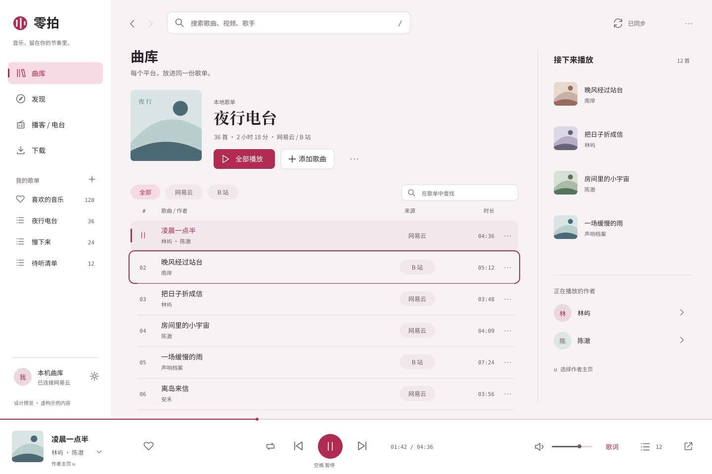
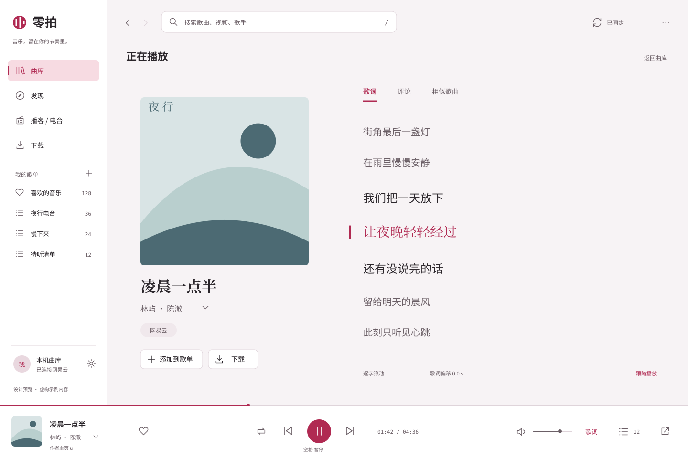
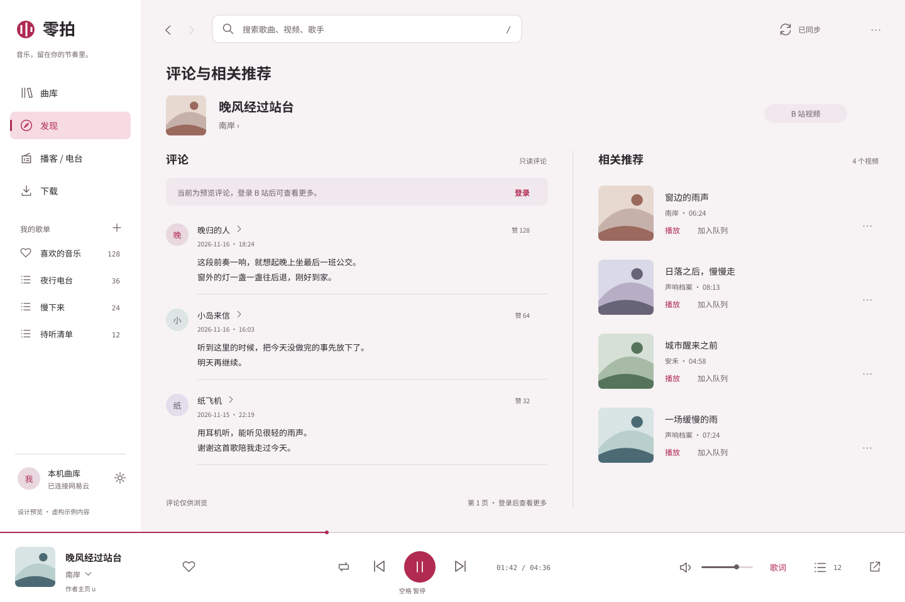
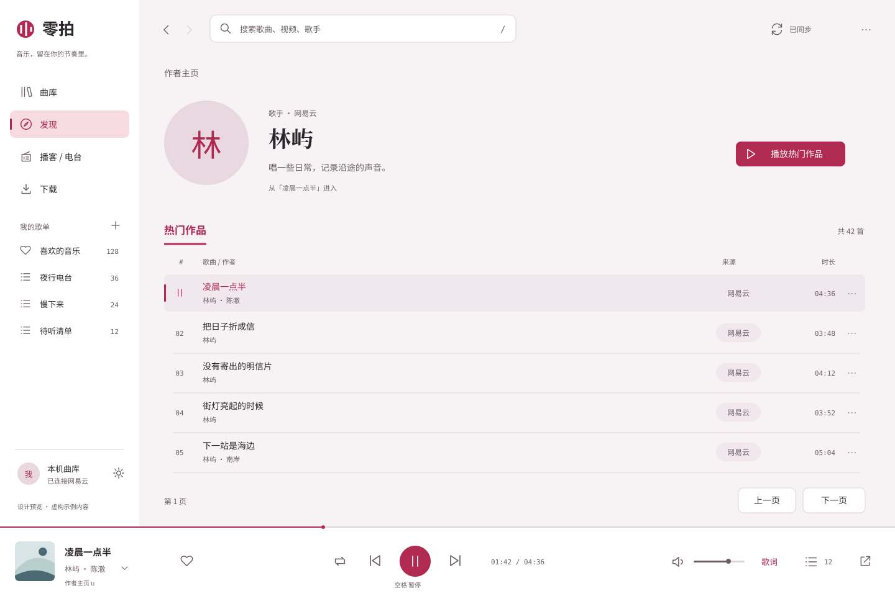
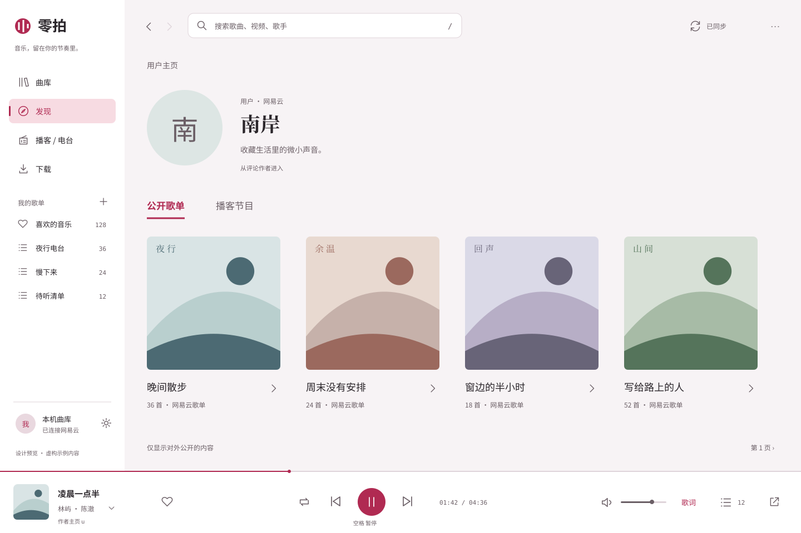
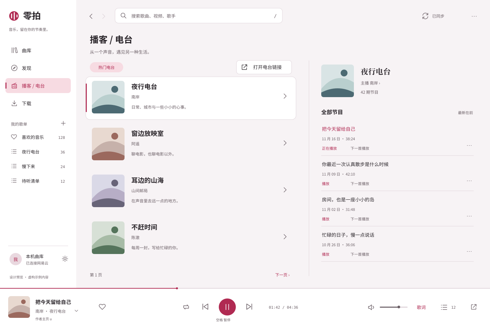
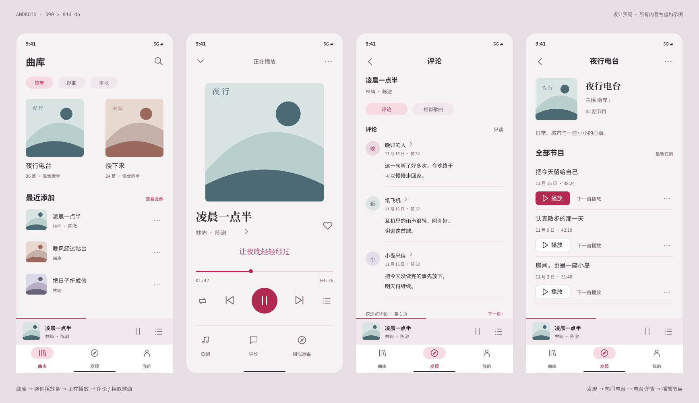
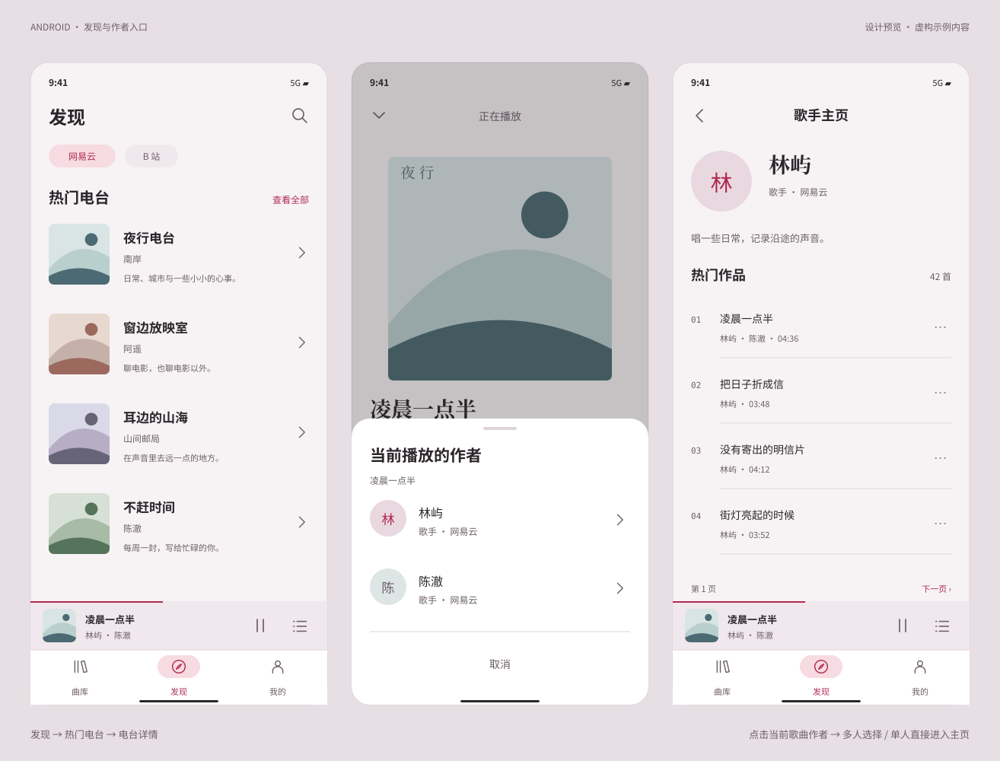
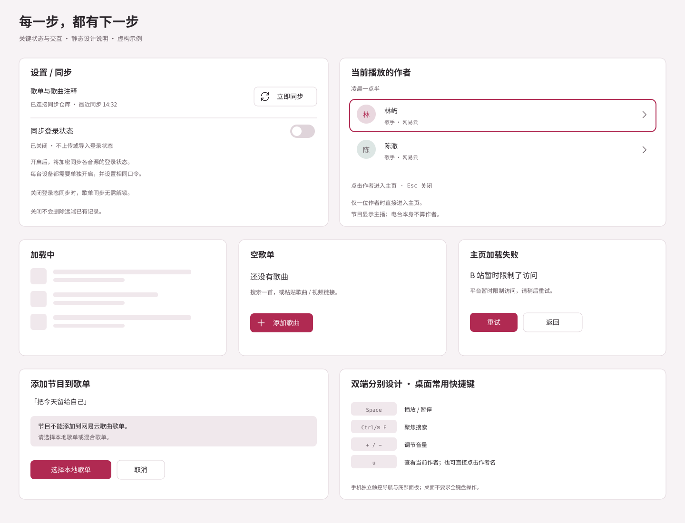

# GUI 界面预览

这是可编辑的 SVG 产品预览，使用虚拟示例数据，未连接平台账号。**桌面与移动端是两套设计**，共用[视觉 token](../design/tokens.json)与业务能力，导航、布局和操作方式分别设计。桌面鼠标优先，仅提供常用快捷键；移动端触控优先。实现行为见[产品与交互规格](13-product-and-interaction.md)。

打开[预览索引](../design/index.html)可切换页面并查看原尺寸；SVG 与生成方式见[设计说明](../design/README.md)。页面目前属于设计产物，不是运行中的 Flutter 截图。

## 桌面曲库

左侧导航与歌单、中间曲目列表、右侧队列和作者、底部播放条。示例刻意让正在播放行与键盘选中行不同，避免混淆「当前作者」和「此曲作者」。

## 正在播放、评论与推荐

歌词使用独立阅读区域；评论和相关推荐保留正在播放上下文，打开后固定内容目标。评论只有阅读与作者主页入口。

## 歌手、用户与播客

歌手作品、用户公开歌单／节目、电台节目用同一套返回与曲目动作。节目使用独立身份，保存到歌单时明确云端歌曲歌单的限制。

## Android 流程

第一组展示曲库、正在播放、评论和电台节目；第二组展示发现、当前多作者选择及歌手主页。每张手机屏幕以 390×844 逻辑像素设计，触控目标至少 48×48；底部播放条与系统安全区域分别处理。

## 状态与常用快捷键

加载、空歌单、平台访问失败、节目保存限制与登录态默认关闭都提供明确下一步。桌面 `u` 可在非输入状态查看当前播放作者，单作者直达、多作者选择；手机点击作者完成相同行为，评论作者由头像／名字进入。GUI 不要求全键盘操作。

2026-11-18 扩展：新增设置／下载、歌词／片段、同步冲突及 Android 文件／账号画板，提供红蓝两色的深浅四套主题。详见[预览索引](../design/index.html)。SVG 为设计对照，实际 Flutter 与设备验证见[验收矩阵](17-full-gui-parity.md)。
